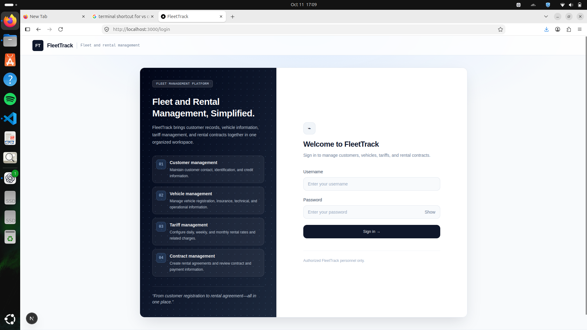
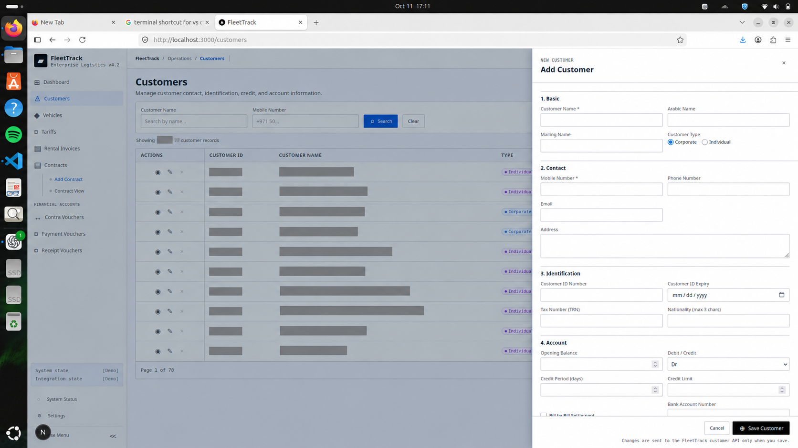
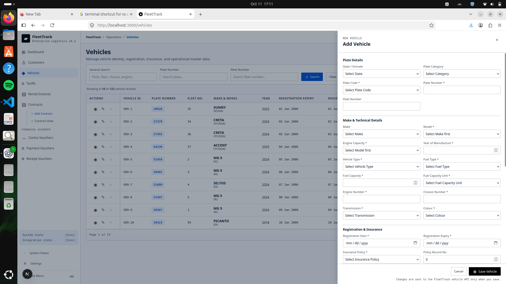
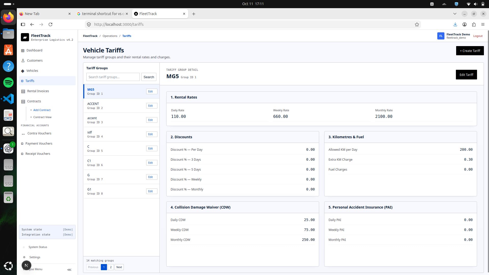
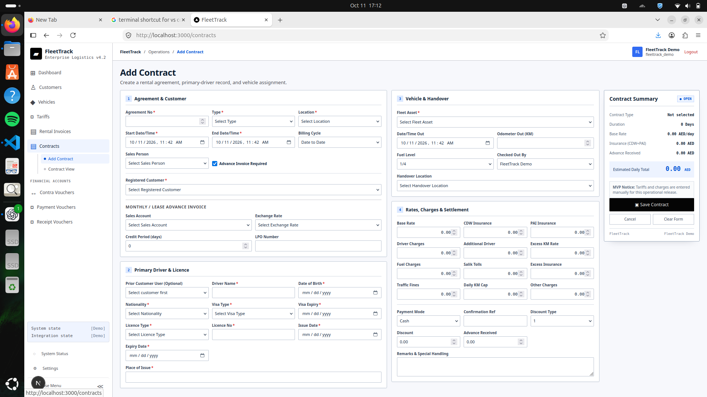

# FleetTrack MVP

FleetTrack is a vehicle rental and fleet-management MVP built around an existing MSSQL ERP database. It combines fleet masters, rental contracts, invoicing, payments, PDC workflows, bank reconciliation, traffic fines, purchase documents, and vehicle finance into a web application for daily rental operations.

The project is intentionally practical: it preserves the legacy database schema, uses generated SQLAlchemy mappings as read-only table definitions, and adds FastAPI/Next.js workflows around verified business slices.

## Screenshots

Customer identifiers in the customer-management screen have been redacted.

### Sign in



### Customer Management



### Vehicle Management



### Vehicle Tariffs



### Rental Contracts



## Tech Stack

- **Backend:** FastAPI, Python, SQLAlchemy, Pydantic
- **Database:** Existing Microsoft SQL Server schema
- **Frontend:** Next.js, TypeScript, Tailwind CSS
- **Architecture style:** router -> service -> repository -> generated SQLAlchemy table metadata
- **Key rule:** `FleetTrack Backend/app/generated_models/models.py` is generated/read-only

## What Is Implemented

| Area                    | Status      | Notes                                                                  |
| ----------------------- | ----------- | ---------------------------------------------------------------------- |
| Authentication          | Implemented | Session-cookie login using existing portal users                       |
| Customers and suppliers | Implemented | Ledger-backed master data screens and APIs                             |
| Vehicles and tariffs    | Implemented | Vehicle CRUD, tariff groups, and tariff rates                          |
| Contracts               | Partial     | Create, view, edit, print, and rental invoice draft support            |
| Sales invoices          | Partial     | Register, rental drafts, fine/salik/misc/vehicle invoice support areas |
| Contra vouchers         | Implemented | Immediate accounting effects on save                                   |
| Payment vouchers        | Implemented | Draft/post/unpost lifecycle with bill allocation                       |
| Receipt vouchers        | Implemented | Draft/post/unpost lifecycle with bill allocation                       |
| PDC workflows           | Implemented | Payable, receivable, and clearance flows                               |
| Bank reconciliation     | Partial     | List bank postings and save statement dates                            |
| Traffic fines           | Partial     | List/search/add; edit/delete are not yet implemented                   |
| Purchase invoices       | Partial     | Draft and verified base-currency posting; inventory posting blocked    |
| Sales quotations        | Partial     | Create/update/delete and approval flag                                 |
| Vehicle finance         | Partial     | Finance schedule generation and finalize-only posting                  |

See [`docs/MVP_STATUS.md`](docs/MVP_STATUS.md) for a more detailed status table.

## Repository Layout

```text
FleetTrack/
├── FleetTrack Backend/       # FastAPI backend
│   ├── app/
│   │   ├── main.py           # App setup and router registration
│   │   ├── generated_models/ # Generated SQLAlchemy mappings; read-only
│   │   ├── database/         # DB session setup
│   │   └── ...               # Feature modules
│   └── tests/                # Focused backend tests
├── FleetTrack Frontend/      # Next.js frontend
│   └── src/app/              # Route screens
├── docs/                     # Architecture, API, status, setup, feature notes
└── reference/                # Screenshots and reference material
```

## Quick Start

Backend:

```bash
cd "FleetTrack Backend"
python -m venv venv
source venv/bin/activate
pip install -r requirements.txt
uvicorn app.main:app --reload
```

Frontend:

```bash
cd "FleetTrack Frontend"
pnpm install
pnpm dev
```

Default local URLs:

- Frontend: `http://localhost:3000`
- Backend API docs: `http://127.0.0.1:8000/docs`

Full setup notes are in [`docs/SETUP.md`](docs/SETUP.md).

## API Overview

Important route families:

```text
/auth
/customers
/suppliers
/vehicles
/vehicle-tariff-groups
/contracts
/sales-invoices
/rental-invoices
/contra-vouchers
/payment-vouchers
/receipt-vouchers
/pdc-payables
/pdc-receivables
/pdc-clearances
/bank-reconciliations
/traffic-fines
/transaction-documents
```

Commercial document workflows share `/transaction-documents/{kind}`, where `kind` includes purchase orders, purchase invoices, sales quotations, credit notes, debit notes, and vehicle finance.

See [`docs/API.md`](docs/API.md) for detailed endpoint notes and [`docs/API_MAP.md`](docs/API_MAP.md) for a compact map.

## Architecture

```text
Browser
  |
  v
Next.js frontend
  |
  v
FastAPI backend
  |
  v
SQLAlchemy Core / generated metadata
  |
  v
Existing MSSQL database
```

The backend keeps business behavior in service modules, persistence in repository modules, and request validation in Pydantic schemas. The database schema is authoritative; this project does not redesign legacy tables.

Read more in [`docs/ARCHITECTURE.md`](docs/ARCHITECTURE.md).

## Development Notes

- Do not edit `generated_models/models.py` by hand.
- Do not change existing MSSQL tables to fit the app.
- Prefer additive APIs and guards over rewriting legacy behavior.
- Keep write paths transactional and evidence-based.
- Treat live database writes as controlled tests, not casual development actions.

## Documentation

- [`docs/SETUP.md`](docs/SETUP.md) - local setup and environment notes
- [`docs/API_MAP.md`](docs/API_MAP.md) - compact route/module map
- [`docs/MVP_STATUS.md`](docs/MVP_STATUS.md) - feature status and known gaps
- [`docs/ARCHITECTURE.md`](docs/ARCHITECTURE.md) - system architecture
- [`docs/CURRENT_STATE.md`](docs/CURRENT_STATE.md) - detailed implementation audit
- [`docs/transactions/`](docs/transactions) - transaction-specific notes

## Current Limitations

This is an MVP, not full legacy ERP parity. Some areas are intentionally blocked until verified against real business rules, especially inventory posting, credit-note posting, foreign-currency edge cases, and traffic-fine edit/delete. The current code also still carries legacy configuration risk around database connection settings; production deployment should move all secrets and connection strings into environment-managed configuration.
