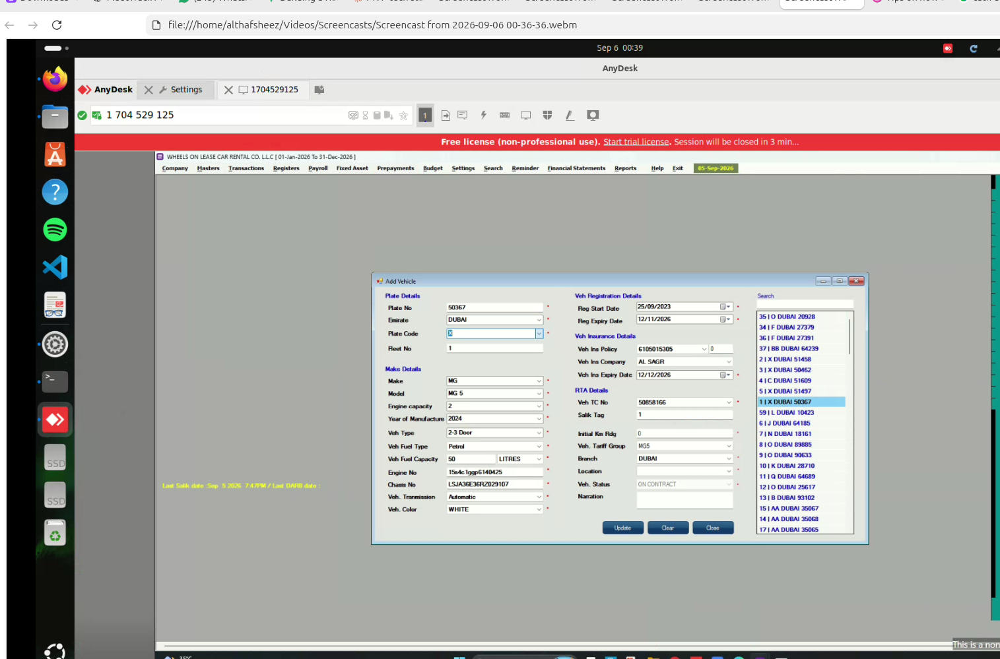
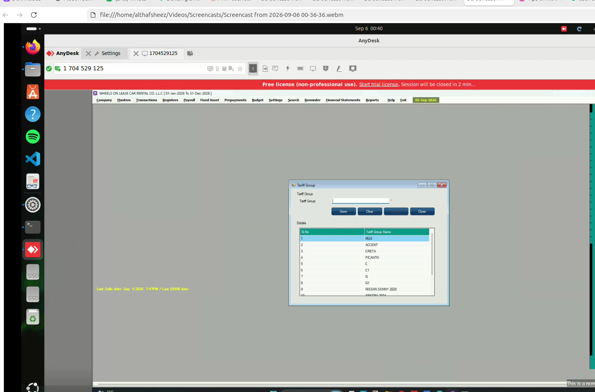
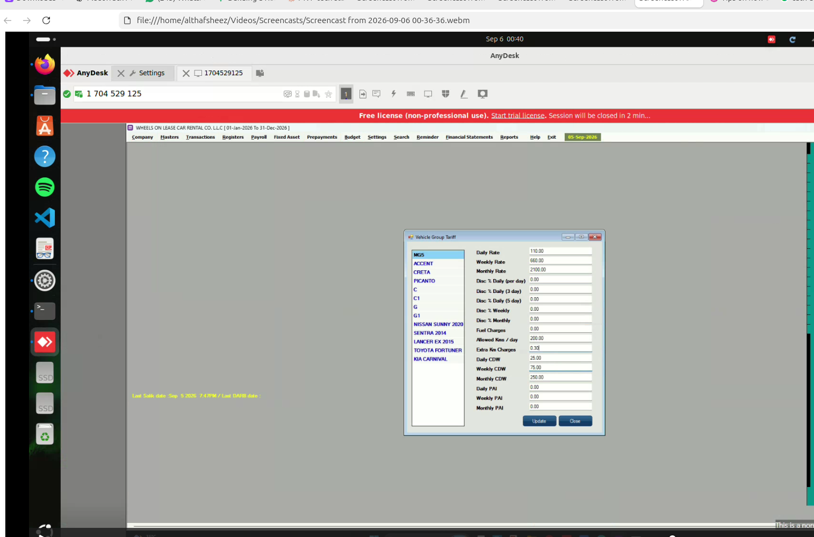
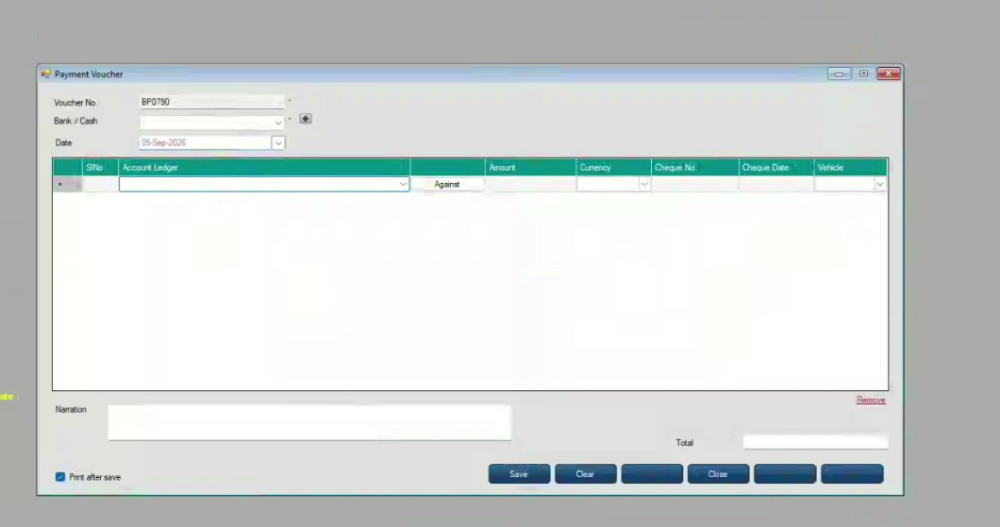
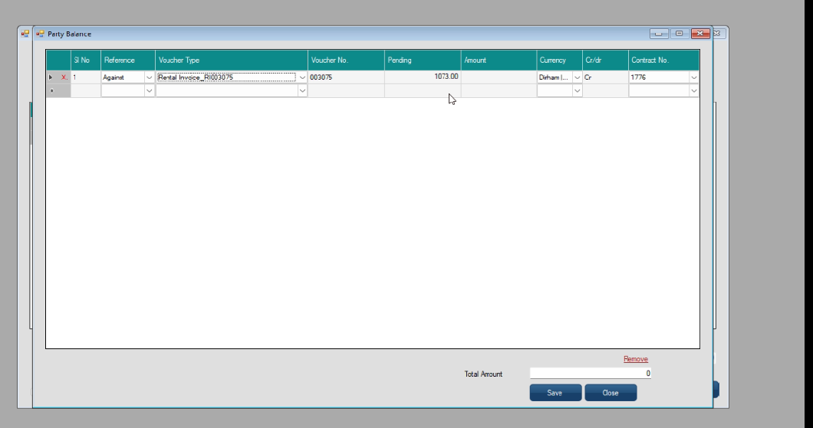
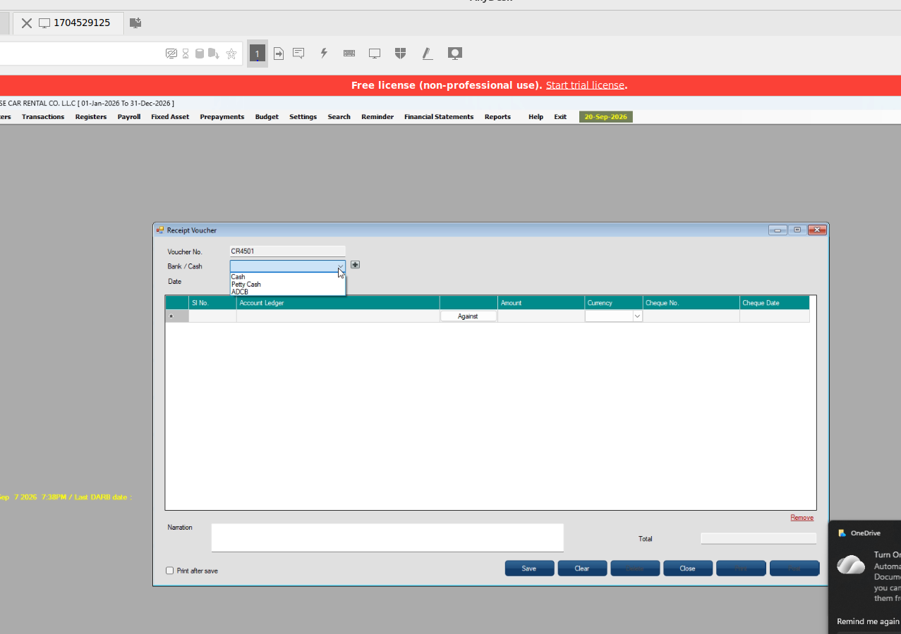
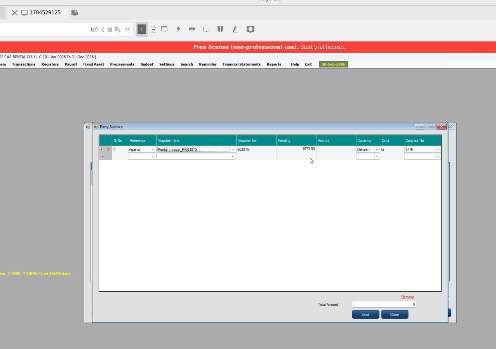
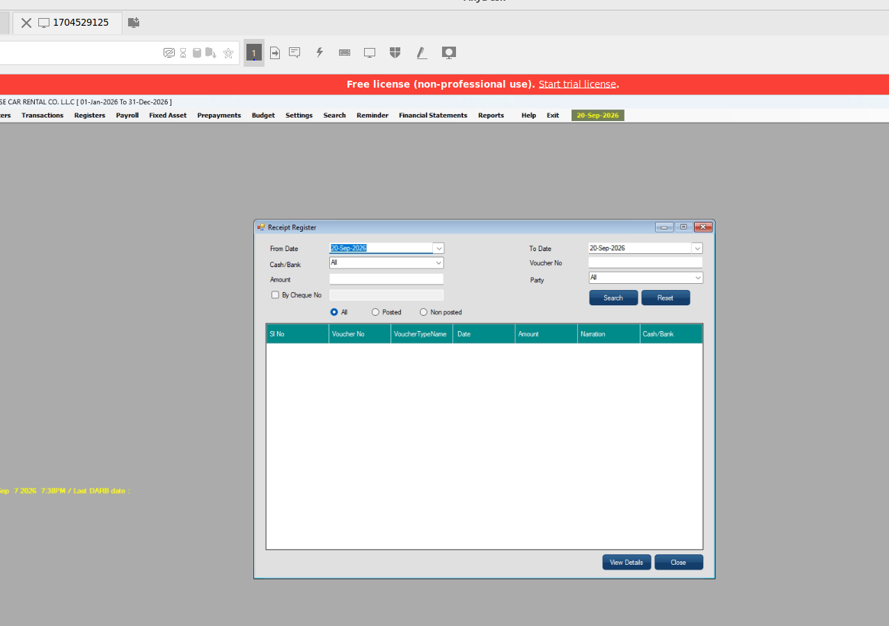
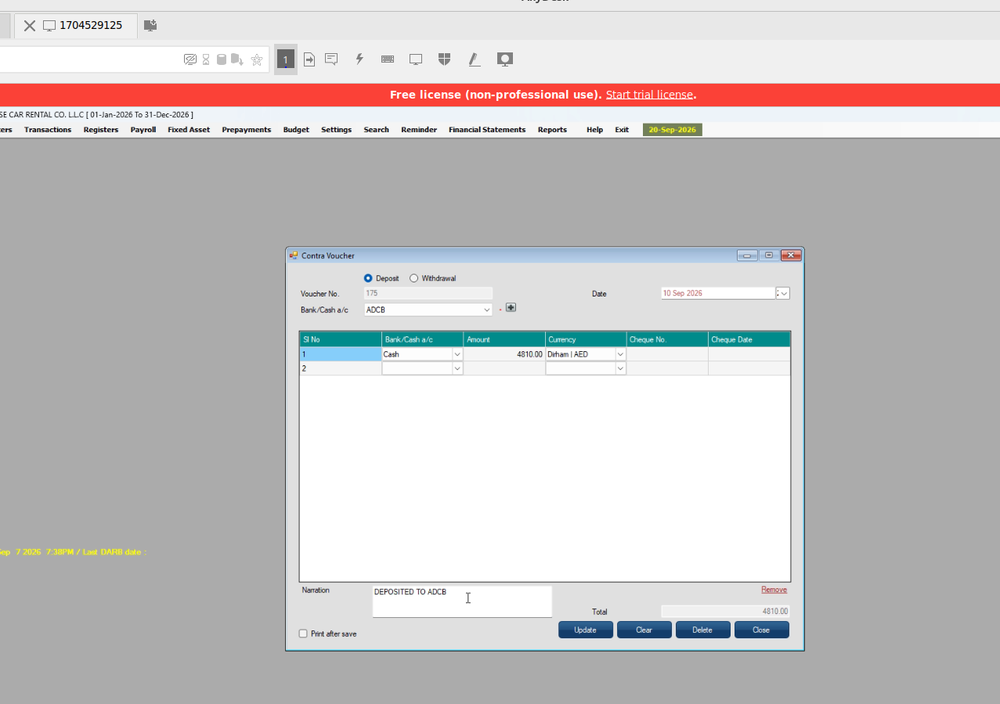

# Screenshots

Reference screenshots are stored under:

```text
reference/screenshots/
```

## Vehicle Screens







## Transaction Screens













## Screenshot Guidance

For future captures, prefer screenshots that show real workflow value:

- dashboard overview with counts or activity
- vehicle register with detail drawer
- contract add/view/print workflow
- sales invoice register
- bank reconciliation table with statement-date editing
- traffic fine add dialog
- purchase invoice editor
- vehicle finance schedule preview

Keep images free of production secrets and personally sensitive customer data before publishing.
